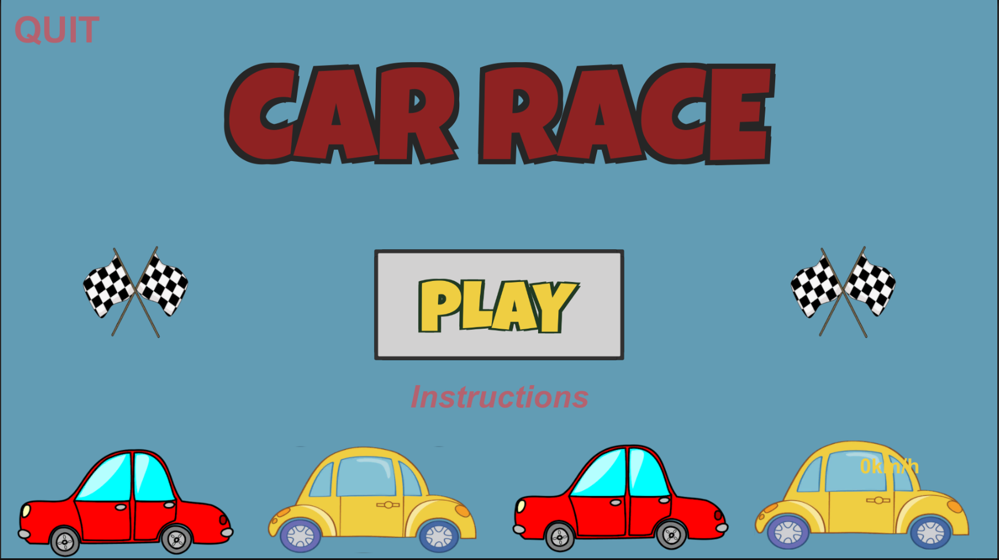
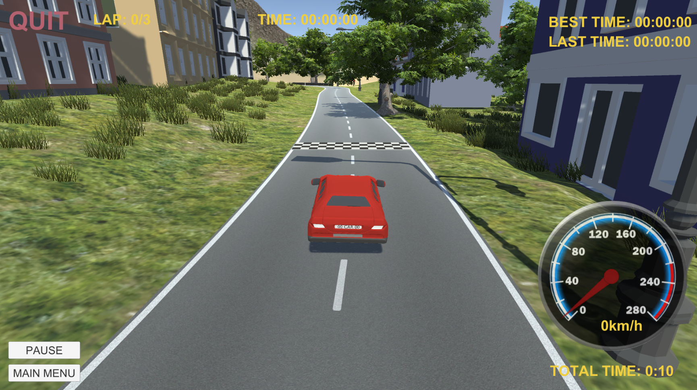
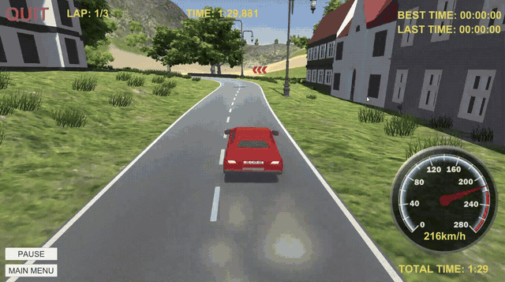
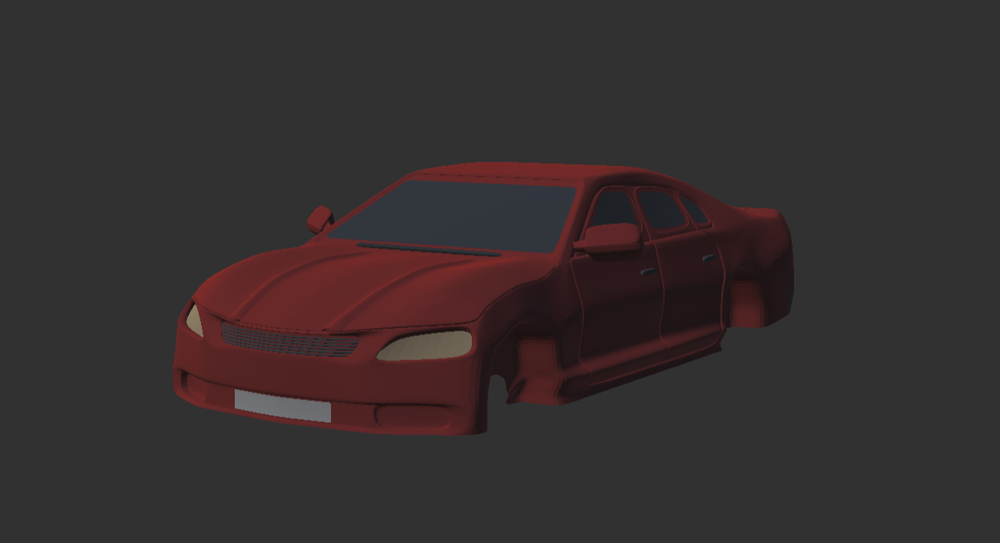
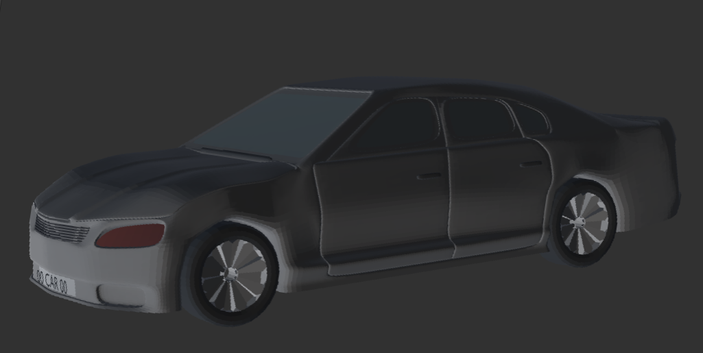
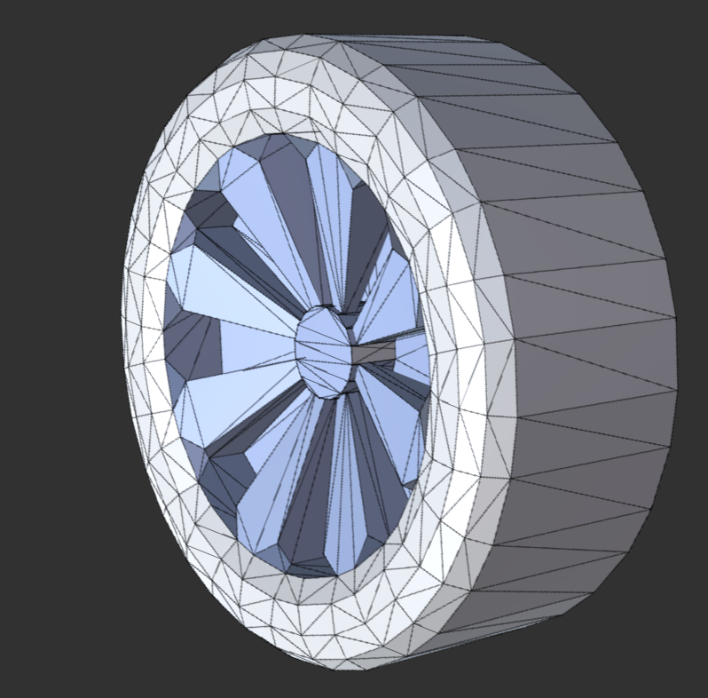
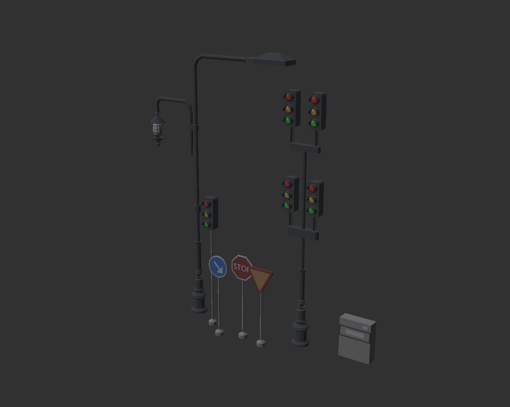
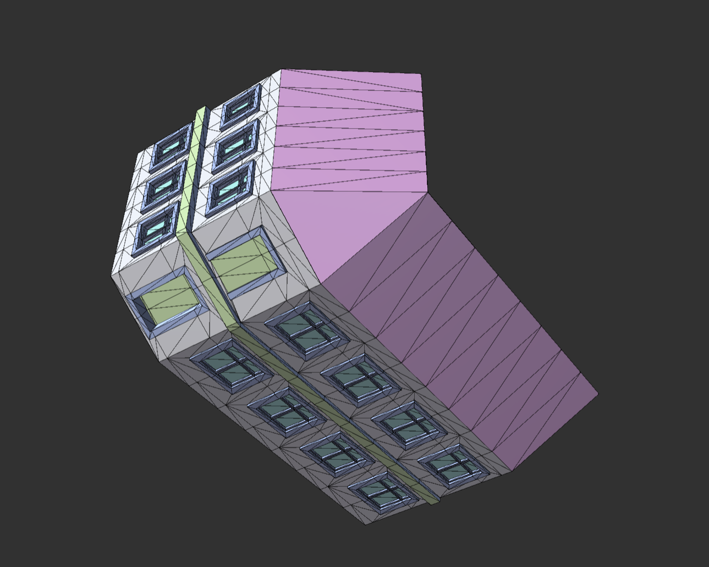

# Car Race 🏎️

Car Race is a 3D racing game project developed in Unity using C# in 2021.

  
  

## Gameplay

- Car Race is a 3D racing game developed in Unity using C#. The goal is to complete three laps around the track as quickly as possible.
- The game includes a timer, lap tracking, best lap time and a speedometer that displays the car's current speed. Players drive through a racing environment with roads, obstacles, buildings, trees and other objects.
- The game also includes a main menu and a finish screen displaying the player's final time.
- Several 3D models, including cars, wheels, buildings and environmental objects, were created in Blender and imported into Unity.

### Short Gameplay Video

[Watch the gameplay video](assets/car-race-gameplay.mp4)

## 3D Modelling

I created 3D models in Blender and imported them into Unity to use them in the game. This project gave me practical experience in 3D modelling, working with meshes and materials, and integrating custom-made 3D assets into a Unity game.

  
  

  
  
  

## Technologies

- Unity
- C#
- Blender
- 3D game development
- 3D modelling

## Development Process

- Created 3D models in Blender, including cars, wheels,
  buildings and environmental objects.
- Imported the 3D models into Unity and used them
  to build the racing environment.
- Developed gameplay features in C#, including
  lap tracking, a timer and a speedometer.

## Project Status

The source code has not yet been published, as I plan to review the project before sharing it.
Additional project files may be added later.
